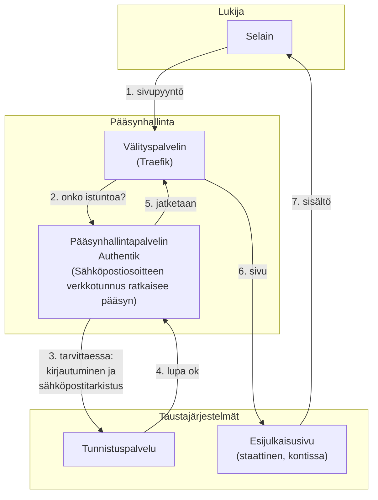

Täällä verkkosivullani on uusi toiminto, joka mahdollistaa kurkistuksen sisältöön ennen kuin se julkaistaan. Toiminnon tarkoitus on mahdollistaa osallisille tarkastaa ja kommentoida julkaisuja ennen kuin ne tulevat yleisesti saataville.

## Mikä esijulkaisu on?

Teksti ei aina synny valmiina. Ensimmäinen versio on lähes aina liian pitkä, huonosti jäsennelty tai muuten vain keskeneräinen. Virheitäkin voi esiintyä.

Artikkeliin tutustuminen onnistuu parhaiten, kun sen voi nähdä samalla alustalla, jolla artikkeli aikanaan julkaistaan. Artikkeliin voi olla liitetty kuvia tai videoita. Jos lähettäisin artikkelista vaikkapa pdf-version kommentoitavaksi, käyttökokemus kuvien ja videoiden käytöstä ei välity samalla tavoin kuin varsinaisella verkkosivulla. 

Sivustosta on nyt olemassa rinnakkaisversio, jossa olen julkaisun lähellä olevia tekstejä hiomassa. Se on täsmälleen samannäköinen kuin varsinainen sivusto. Rinnakkaissivulla on sama ulkoasu, sama rakenne ja sama sisältö. Erona on vain ne tekstit, joita ei ole vielä julkaistu.

Idea on yksinkertainen: kun jokin kirjoitus on siinä kunnossa, että se voisi hyötyä toisesta näkemyksestä tai mielipiteestä, siirrän sen esijulkaisuun. Siellä tekstiä voi lukea ja selailla.

## Mitä esijulkaisu ei ole?

Vastuu artikkeleista pysyy edelleen minulla, tekstin kirjoittajalla ja julkaisijalla.

Vaikka pyytäisin kommenttia tai mielipidettä julkaisuun, se **ei tarkoita vastuun siirtoa kommentoijalle**.

## Kenelle se on tarkoitettu?

Esijulkaisu ei ole avoin kaikille. Jos se olisi, rinnakkaissivun merkitys olisi menetetty.

Rinnakkaissivulle pääsy edellyttää siis kirjautumista. Kirjautuminen tapahtuu käyttäen yritykseni tunnistuspalvelua. Mutta ei huolta, kirjautuminen on helppoa. Kirjautumiseen käytetään **sähköpostiosoitetta**.

Minun on mahdollista antaa etukäteinen lupa päästä sivulle sähköpostiosoitteesi perusteella.

## Tarvitsetko pääsyn?

Todennäköisesti olen kertonut sinulle erikseen, jos sinulla on mahdollisuus käyttää esijulkaisu-toimintoa.

Jos et löydä toimintoa tai et pääse käyttämään sitä, voit myös pyytää pääsyä. Sivuston oikeassa yläreunassa on **Ota yhteyttä** -linkki. Lähetä sen kautta lyhyt viesti, jossa kerrot haluavasi pääsyn esijulkaisuun.

Saat minulta sitten tiedon, kun pääsy on avattu. Tai jos olen eri mieltä, kerron, miksi en tällä kertaa avannut pääsyä rinnakkaisjulkaisuun.

## Mitään uutta ei tarvita

Sinun ei siis tarvitse rekisteröityä mihinkään tai ottaa käyttöön mitään uutta sovellusta. Rinnakkaisjulkaisu toimii tavallisella verkkoselaimella. Ja kirjautuminen perustuu sähköpostiosoitteeseesi.

## Tekniikasta kiinnostuneelle

Ratkaisu rakentuu olemassa olevan julkaisukanavan rinnalle ilman, että itse sivun sisältöä tai julkaisuprosessia tarvitsee muuttaa. Sivusto on rakennettu staattiseksi: [Jekyll](https://jekyllrb.com/)-moottori kokoaa tekstit ja asettelun. Palvelimella ei pyöri mitään sisällöntuotantoa.

Esijulkaisu syntyy samasta lähdekoodista. Se on omassa haarassaan versiohallinnassa. Versiohallinnan käynnistämä automaatio julkaisee uuden version, kun sivustoon tehdään muutoksia.

Haaraa ajetaan varsinaisesta sivustosta erillisessä kontissa. Kontin edessä on [Traefik](https://doc.traefik.io/traefik/) välityspalvelin, joka valvoo tunnistusistunnon voimassaoloa, tarvittaessa ohjaa tunnistamiseen ja tekee TLS-salauksen.

Pääsynhallinta tehdään niinikään välityspalvelimen yhteydessä. Ennen kuin pyyntö välitetään varsinaista sivustoa tuottavaan konttiin, välityspalvelin kysyy pääsynhallinnasta ([Authentik](https://goauthentik.io/)), onko pyynnön tekijällä voimassa oleva istunto. Ellei ole, pyyntö ohjataan kirjautumiseen. Kirjautuminen tapahtuu yritykseni [tunnistuspalvelussa](https://www.olevi.fi/). Tunnistuspalvelussa varmistetaan kertakäyttökoodilla, että käyttäjällä on pääsy ilmoittamaansa sähköpostiin.

Halutessaan käyttäjä voi hyödyntää myös laitetunnistetta ([Passkeys](https://fidoalliance.org/passkeys/)). Tämä helpottaa myöhempiä kirjautumisia, mutta toisaalta laitetunniste on rekisteröitävä tunnistuspalvelussa, jotta sitä voi käyttää myöhemmin uudelleen.

Kokonaisuus toimii siten kolmen kerroksen ketjuna:

1. Julkaisuhaara versiohallinnassa tuottaa saman sisällön kuin varsinainen sivusto lisättynä varsinaista julkaisua odottavilla artikkeleilla
2. Staattinen sivusto paketoidaan ja ajetaan erillisessä kontissa
3. Tunnistaminen ja käyttöoikeus selvitetään yritykseni tunnistuspalvelussa

Käyttäjätiedoksi tunnistuspalveluun ja pääsynhallintaan tallennetaan ainoastaan sähköpostiosoite, jolla käyttäjä on kirjautunut esijulkaisuun. Jos käyttäjä rekisteröi laitetunnisteen, sen julkinen avain tallennetaan käyttäjän tietoihin, jotta käyttäjä voi myöhemmin kirjautua uudelleen vahvistamatta sähköpostiosoitetta uudelleen.

Lokitietoja lukuunottamatta muita henkilötietoja ei käsitellä tai tallenneta. Evästeitä käytetään ainoastaan istunnon valvontaan. Koska evästeiden käyttö on välttämätöntä käyttäjän pyytämän palvelun tuottamiseksi, niiden tallentamiseen ei kysytä suostumusta.

Ketjun ensimmäinen pyyntö ohjataan aina pääsynhallintaan. Kun istunto on kerran muodostettu, käyttäjä liikkuu sivustolla vapaasti ilman uusia kirjautumisia.